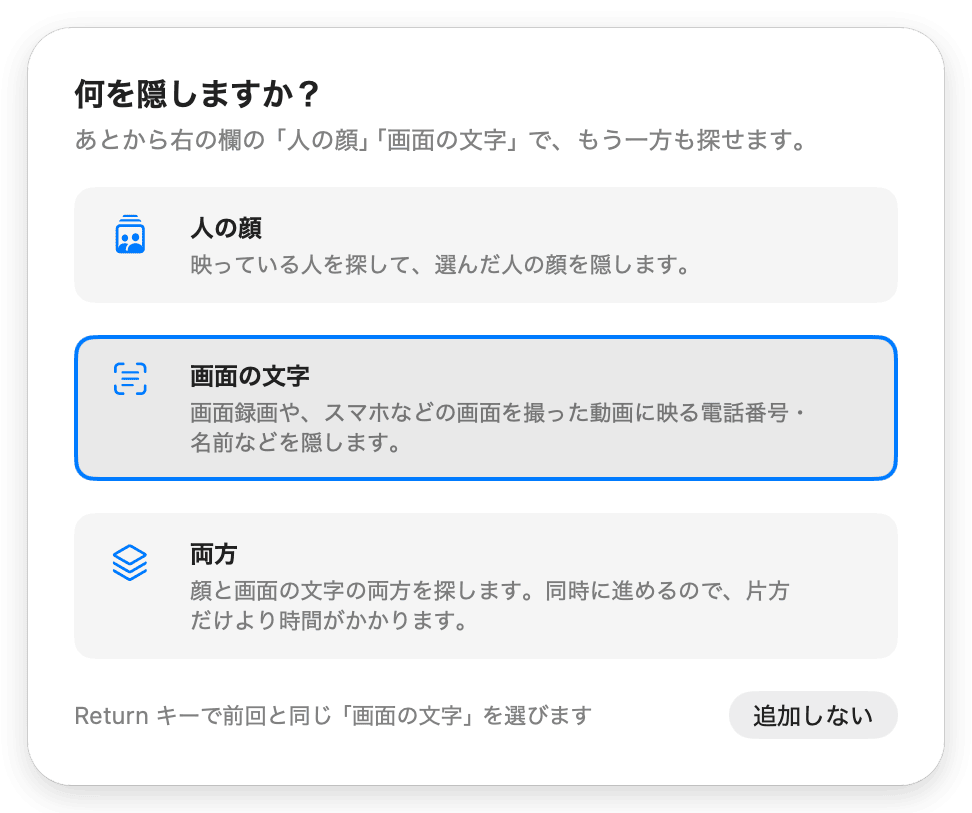
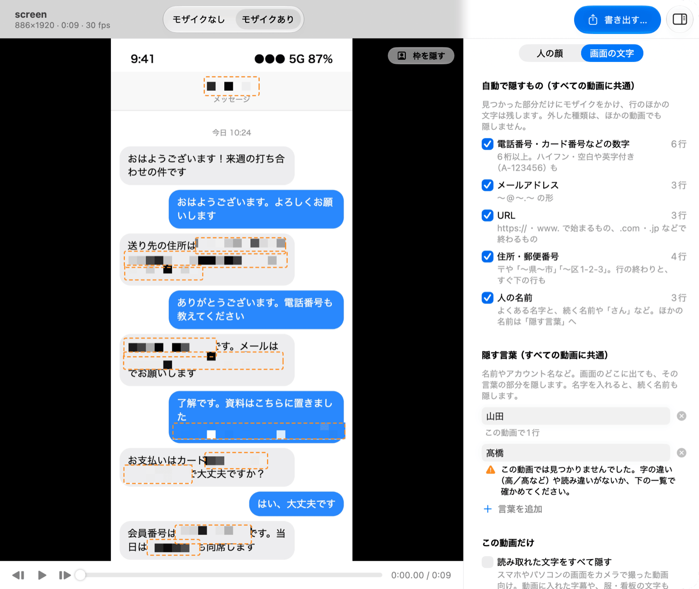
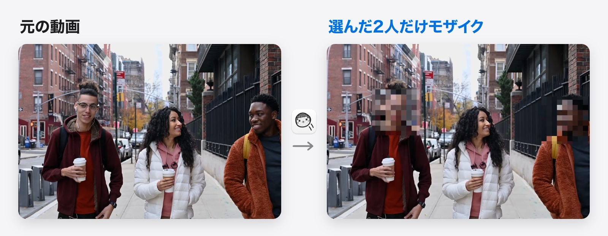
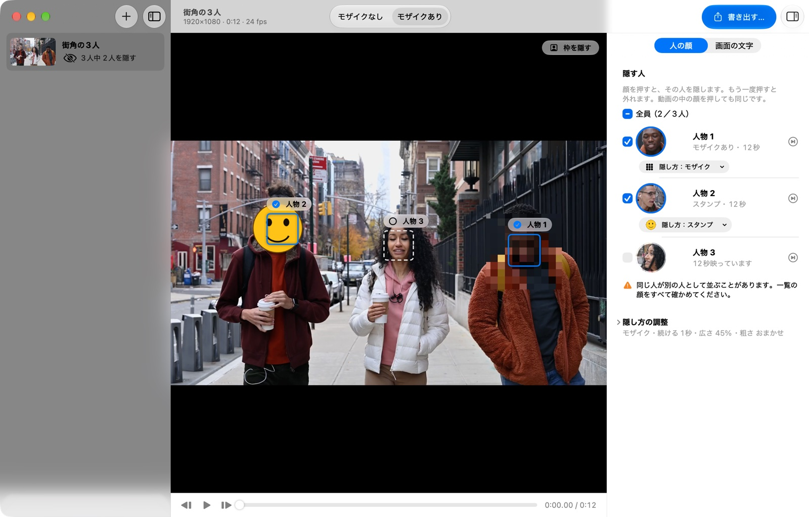
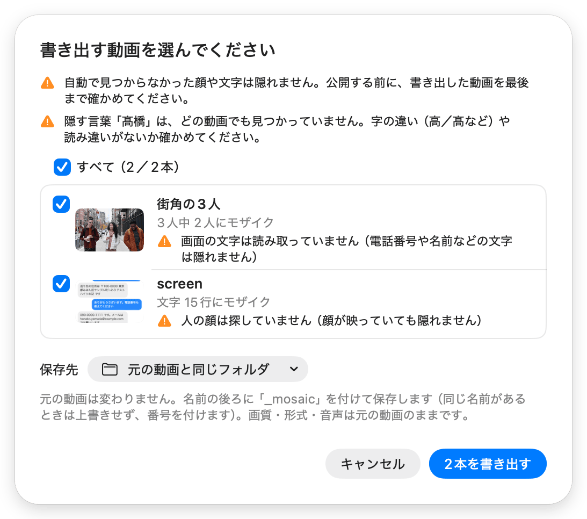

<p align="center">
  
</p>
<h1 align="center">モザイぷーん</h1>
<p align="center">
  <b>動画に映った個人情報に、自動でモザイク。</b><br>
  名前・住所・電話番号・メールアドレス、映り込んだ人の顔。<br>
  動画の中から見つけて隠す、Mac 用の無料アプリです。
</p>
<p align="center">
  <a href="https://github.com/mhimt-lab/mozaipoon/releases/latest/download/Mozaipoon.zip"><b>ダウンロード（無料）</b></a><br>
  <sub>macOS 26 以降 ・ アップロードなし ・ ログインなし</sub>
</p>


<sub>スマホの画面をカメラで撮った動画（再現）。画面の名前・住所・電話番号などは、すべて架空のものです</sub>

> [!IMPORTANT]
> 自動で見つからなかった文字や顔は隠れません。公開する前に、書き出した動画を最後まで再生して確かめてください。

## こんなときに

- 商品紹介やレビューで撮ったスマホの画面に、自分の名前や住所、電話番号が映ってしまった
- 画面録画に、メッセージの相手の名前や連絡先が映っている
- 映り込んだ個人情報を 1 コマずつ手作業で消していて、動画の公開が遅れている
- 街やイベントで撮った動画に、通行人の顔が映っている
- 動画を外部のサービスにアップロードしたくない

## 使い方は 3 ステップ

1. **動画をドロップします。** 何を隠すか（画面の文字／人の顔／両方）を選ぶと、動画の中の文字や顔を自動で探します
2. **隠すものを確かめます。** 見つかった電話番号・住所・名前などは、種類ごとに行数が出ます。自動で見つからない名前やアカウント名は「隠す言葉」に入れます。顔は、一覧から隠したい人を選びます
3. **「書き出す…」を押します。** 見つかった部分にモザイクがかかります。画質と音声は元の動画のままです

<p align="center">
  
</p>

## 名前・住所・電話番号を隠す

電話番号・カード番号などの数字・メールアドレス・URL・住所・人の名前を自動で見つけて、その部分にモザイクをかけます。行のほかの文字は残ります（画面を斜めに撮った動画では、まわりの文字も一緒に隠れることがあります）。

- **スマホやパソコンの画面を撮った動画**（商品紹介・レビューなど）：手で動かしても、モザイクは文字を追いかけます。画面の文字をまとめて隠したいときは「読み取れた文字をすべて隠す」を使います
- **画面録画**：スクロールしても、通知が出ても、見つけた部分を追いかけて隠します
- **自動で見つからない名前やアカウント名**：「隠す言葉」に入れると、画面のどこに出ても隠します。入れた言葉が動画の中で見つからないときは知らせます


<sub>左：元の画面録画　右：書き出した動画。表示している名前・住所・電話番号・メールアドレスは、すべて架空のものです</sub>



<sub>見つかった行数は種類ごとに出ます。一時停止すると、隠す範囲がオレンジの点線で出ます</sub>

## 映り込んだ人の顔を隠す

映っている人を自動で探して、人ごとに並べます。隠したい人を選ぶと、その人の顔だけにモザイクがかかります。通行人が多いときは「全員」を選んでから、残したい人だけ外せます。

隠し方は、モザイクのほかに**ぼかし**も選べます。人ごとに、好きな画像（自分の顔の切り抜きなど）を顔に重ねる**スタンプ**にもできます。



<sub>サンプル映像：Keira Burton（[Pexels](https://www.pexels.com/video/people-walking-on-a-sidewalk-6146486/)）</sub>



<sub>右の一覧で顔を押すと、その人の顔が隠れます。人ごとの「隠し方」で、モザイク・ぼかし・スタンプを選べます。書き出す前に「隠した表示」で、仕上がりと同じ見た目のまま再生できます</sub>

## 動画はどこにも送りません

- アップロードなし・ログインなし。アプリに通信の機能がありません
- 顔を探すのも、文字を読むのも、書き出すのも、すべてこの Mac の中で行います
- 元の動画は変更しません。隠した動画を、別のファイルとして保存します
- 無料で、プログラムはすべて公開しています（MIT License）

## 公開前に、必ず最後まで確認を

自動で探すのは完全ではありません。確かめやすいように、モザイぷーんは次のことをします。

- 書き出す前に、「隠した表示」で、仕上がりと同じ見た目のまま再生できます
- 書き出した後、隠している顔の数が急に減った場面を「確かめてほしい場面」として知らせます
- 入れた「隠す言葉」が動画の中で見つからないときや、探していないもの（顔か文字）があるときは、書き出す前に知らせます

<p align="center">
  
</p>

苦手なものもあります。

- **名前**：珍しい名字、ニックネーム、カタカナやローマ字だけの名前は自動では見つかりません。**隠したい名前は「隠す言葉」に入れてください**
- **文字**：小さい文字、画像の中の文字、一瞬だけ映った文字、とても速いスクロール中の文字。画面を撮った動画では、ブレや反射で読み取れない文字
- **顔**：最初から横顔のままの人、マスクをした顔、とても小さい顔。隠せるのは顔だけで、後ろ姿や服は隠せません

くわしくは [隠せるもの・隠せないもの](docs/LIMITATIONS.md) をご覧ください。

## ダウンロードと最初の起動

**[モザイぷーんをダウンロード（無料）](https://github.com/mhimt-lab/mozaipoon/releases/latest/download/Mozaipoon.zip)**

<sub>うまくダウンロードできないときは、[リリースのページ](https://github.com/mhimt-lab/mozaipoon/releases/latest) の「Assets」にある zip を選んでください</sub>

使える Mac：macOS 26 以降（Apple シリコン／Intel。Intel の Mac での動作はまだ確かめていません）

> スマホでご覧の方へ：このアプリは Mac 用です。このページのリンクを自分宛てに送って、Mac で開いてください。

1. ダウンロードした zip をダブルクリックして開き、出てきた「モザイぷーん」を「アプリケーション」フォルダへ移します
2. 「モザイぷーん」をダブルクリックします。**最初の 1 回だけ**、「開いていません」という表示が出て開けません。表示は閉じてください（「ゴミ箱に入れる」は押さないでください）
3. 「システム設定」▸「プライバシーとセキュリティ」を開き、下のほうにある「このまま開く」を押します。Mac のパスワードを入れると開きます
4. 2 回目からは、ふつうにダブルクリックで開けます

<details>
<summary>なぜ最初だけこの表示が出るの？</summary>

モザイぷーんは、Apple の「公証」という確認を受けていません。公証を受けていないアプリは、最初に開くときにこの表示が出ます。

プログラムの中身はこのページですべて公開していて、通信の機能はありません。気になる方は、公開されているプログラムから自分でアプリを作ることもできます（下の「開発者の方へ」）。
</details>

## よくある質問

<details>
<summary>本当に無料ですか？</summary>

はい。無料で、広告や登録もありません。MIT License のオープンソースです。
</details>

<details>
<summary>動画はどこかに送られますか？</summary>

送られません。アプリに通信の機能がなく、処理はすべてこの Mac の中で行います。
</details>

<details>
<summary>画質は落ちますか？元の動画は消えませんか？</summary>

元の動画と同じ形式（H.264・HEVC・ProRes など）で書き出し、音声はそのままコピーします。元の動画は変更せず、名前の後ろに「_mosaic」を付けた別のファイルとして保存します。
</details>

<details>
<summary>長い動画でも使えますか？どのくらい時間がかかりますか？</summary>

使えます。顔を探す時間は、40 分のレビュー動画（1080p・60fps）で約 32 分、動画の長さの約 0.8 倍でした。30fps の動画なら約 0.6 倍です。映っている人が多いほど長くかかります。書き出しには、別に動画の長さの約 0.2 倍かかります。

画面の文字の読み取りは、映っている文字が多いほど時間がかかります。スマホの画面をカメラで撮った 2 分の動画（1080p・60fps）で 30 秒〜1 分 40 秒ほど、動画の長さの 0.3〜0.8 倍でした。メモリが 16GB より少ない Mac では、同時に読み取る数を減らすので、もっとかかります。

どれも M3 Max の Mac で測った目安です（2026 年 11 月）。M1・M2 などの Mac ではまだ測っていません。
</details>

<details>
<summary>どんな動画を開けますか？</summary>

MOV・MP4・M4V など、Mac で再生できる動画です。MKV・WebM などは、MP4 や MOV に変換してから使ってください。くわしくは [隠せるもの・隠せないもの](docs/LIMITATIONS.md#対応している動画形式) をご覧ください。
</details>

<details>
<summary>モザイクの代わりに、ぼかしや画像で隠せますか？</summary>

できます。「隠し方の調整」の「基本の隠し方」で、モザイクとぼかしを切り替えられます（顔と画面の文字の両方に使います）。顔は人ごとに、好きな画像を重ねる「スタンプ」にもできます。選んだ人の行の「隠し方」メニューから画像を選んでください。顔の写真なら、写真の顔を動画の顔に合わせて重ねます。背景を透明にした切り抜き画像がおすすめです。くわしくは [詳しい使い方](docs/USAGE.md) をご覧ください。
</details>

<details>
<summary>字幕を入れた後の動画にも使えますか？</summary>

使えます。ただし「読み取れた文字をすべて隠す」は字幕も隠すので、そのときは字幕を入れる前の動画に使ってください。
</details>

<details>
<summary>Windows や iPhone で使えますか？</summary>

使えません。Mac（macOS 26 以降）専用です。
</details>

<details>
<summary>うまく隠れないときは？</summary>

名前やアカウント名は「隠す言葉」に入れてください。動画の中の顔を押しても、その人を選べます。それでも困ったときは、[Issues](https://github.com/mhimt-lab/mozaipoon/issues) で教えてください。
</details>

## もっと詳しく

- [詳しい使い方とショートカット](docs/USAGE.md)
- [隠せるもの・隠せないもの](docs/LIMITATIONS.md)

### 開発者の方へ

Xcode は不要です。Command Line Tools の Swift 6 でビルドできます。

```sh
git clone https://github.com/mhimt-lab/mozaipoon.git
cd mozaipoon
bash scripts/build-app.sh          # アプリ: build/モザイぷーん.app
swift build -c release             # CLI:   .build/release/wipe-mosaic
```

- [コマンドライン版（CLI）](docs/CLI.md)
- [開発者向けの情報（仕組み・テスト・アイコンの作り方など）](docs/DEVELOPMENT.md)

## ライセンス

MIT License（[LICENSE](LICENSE) を参照）。サンプル映像は Keira Burton（Pexels）によるものです。
