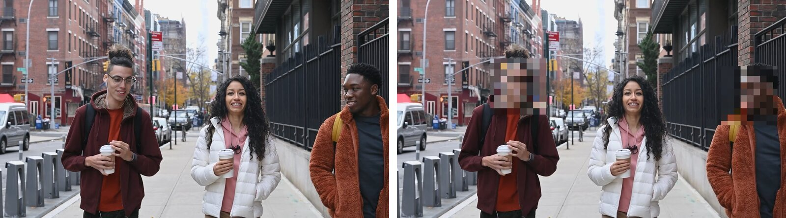

# モザイぷーん


動画に映っている顔を自動で探して人ごとにまとめ、**選んだ人の顔だけ**にモザイクをかける macOS アプリと CLI。


**使い方は 3 ステップ**

1. 動画をウインドウにドロップする。映っている人を自動で見つけて、人ごとに一覧にする
2. 隠したい人にチェックを入れる（「全員」を選んでから残したい人だけ外すこともできる）
3. 「書き出す…」を押す。選んだ人の顔だけにモザイクがかかり、画質は元の動画のまま



<sub>左：元の動画 / 右：書き出した動画。サンプル映像：Keira Burton（[Pexels](https://www.pexels.com/video/people-walking-on-a-sidewalk-6146486/)）</sub>

## Mac の中だけで完結する

- **アップロードなし・ログインなし・通信なし**。アプリにも CLI にもネットワーク通信の処理はない
- 顔の検出・人のまとめ・モザイク・書き出しは、macOS 標準の Vision（顔検出・特徴量）・Core Image（モザイク）・AVFoundation（読み書き）だけで、すべてこの Mac の中で行う。クラウドの AI サービスには送らない
- 登録した顔写真は `~/Library/Application Support/WipeMosaic/faces/` に、設定は UserDefaults に保存するだけで、どこにも送らない

街中やイベントで撮った動画の通行人、行事や社内向けの動画に映った人など、「この人の顔だけ隠したい」ときに使う。

## 動作環境と入手

- macOS 26 以降
- ビルド済みのアプリは配布していない。下の手順で自分の Mac でビルドする（Xcode は不要。Command Line Tools の Swift 6 でビルドできる）
- MXF など AVFoundation が開けない形式を読むときだけ ffmpeg（`brew install ffmpeg`）を使う（下の「対応している動画形式」）

```sh
git clone https://github.com/mhimt-lab/mozaipoon.git
cd mozaipoon
bash scripts/build-app.sh          # アプリ: build/モザイぷーん.app
swift build -c release             # CLI:   .build/release/wipe-mosaic
```

アプリは `/Applications` などへコピーして使ってよい（ad-hoc 署名のローカル専用アプリ）。

## できること

- **人ごとに一覧**：動画を入れると映っている人を自動で探し、人ごとに顔写真付きで並べる。何本でもまとめて追加できる
- **選んだ人だけ隠す**：顔をクリックするだけ。通行人が多いときは「全員」を選んでから、残したい人だけ外せる
- **動いても追いかける**：横を向いたり速く動いたりして顔が見えにくい場面も、頭を追いかけてモザイクを続ける
- **その場で確認**：「モザイクあり」の表示で、書き出しと同じ見た目のまま再生できる。書き出した後は、モザイクが減った場面を「確かめてほしい場面」として知らせる
- **見た目の調整**：モザイクの広さ・粗さ、顔の前後も続ける時間を変えられる
- **顔写真の登録**：よく隠す人の顔写真を設定（⌘,）に登録しておくと、似ている人に最初からチェックが入る
- **画質はそのまま**：元の動画と同じ形式（H.264・HEVC・ProRes など）で書き出し、音声はそのままコピーする。元のファイルは変更しない

## 対応している動画形式

- 開ける：MOV・MP4・M4V など macOS で再生できる動画（H.264・HEVC・ProRes・AV1 など）
- MXF（Sony FX6/FX3 など）：ffmpeg（`brew install ffmpeg`）が入っていれば、自動で読める形にして開く
- 開けない：MKV・WebM・WMV・FLV（MP4 や MOV に変換してから使う）

## 使うときの注意

- 隠せるのは**顔だけ**。後ろ姿・名札・画面に映った名前などは対象外
- 最初から横顔のまま登場した顔、マスクをした顔、とても小さい顔は見落とすことがある
- 同じ人が 2 人に分かれて一覧に出ることがある。一覧の顔はすべて確かめる
- 登録した顔写真との照合は目安。最初からチェックが入った人も、入っていない人も確かめる
- **公開する前に、書き出した動画を必ず最後まで見て確認する**

## もっと詳しく

- 操作とショートカットの一覧：[docs/USAGE.md](docs/USAGE.md)
- コマンドライン版（ターミナルから同じ処理を実行）：[docs/CLI.md](docs/CLI.md)
- 開発者向けの情報（仕組み・テスト・アイコンの作り方など）：[docs/DEVELOPMENT.md](docs/DEVELOPMENT.md)

## ライセンス

MIT License（`LICENSE` を参照）。
