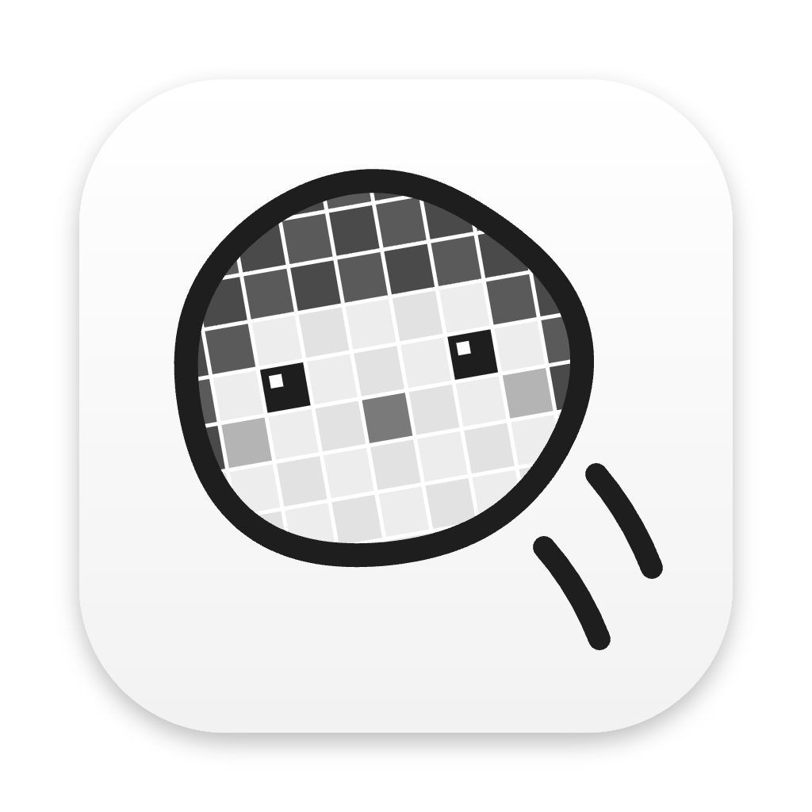
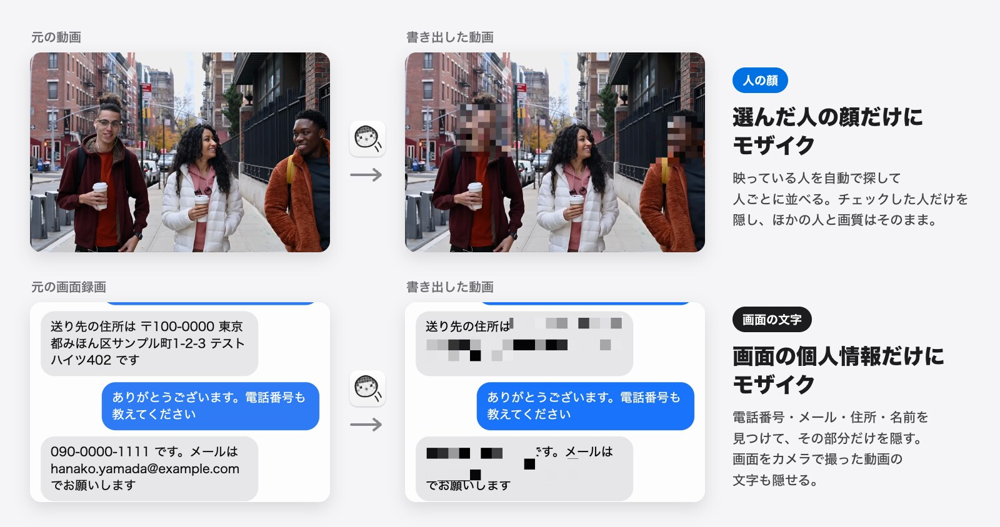
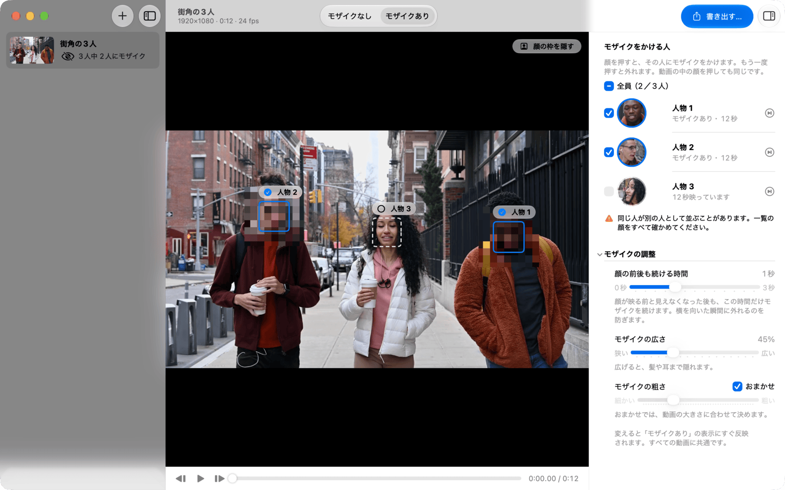
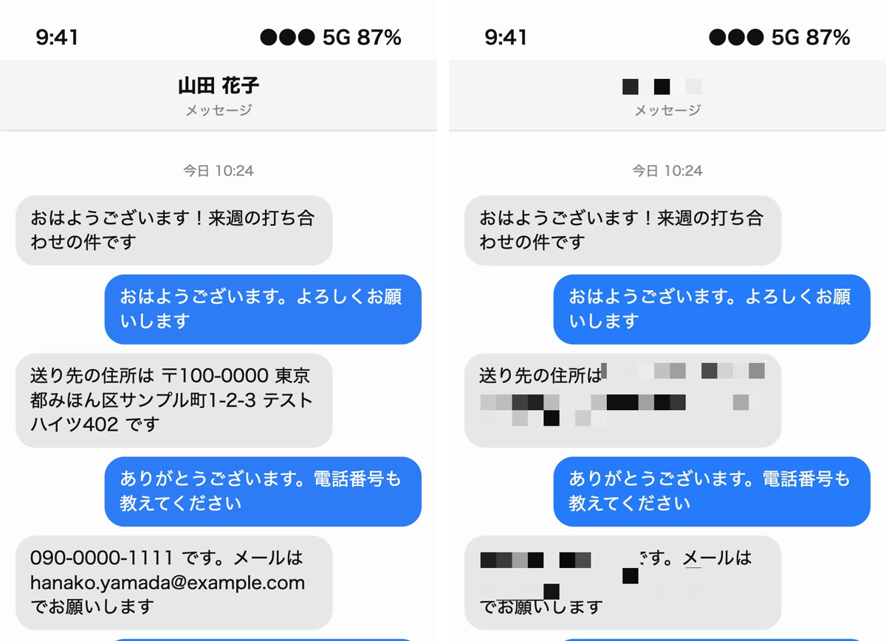

# モザイぷーん



動画に映っている顔を自動で探して人ごとにまとめ、**選んだ人の顔だけ**にモザイクをかける macOS アプリと CLI。iPhone などの画面録画や、スマホの画面をカメラで撮った動画に映る電話番号・メールアドレス・名前などの文字も隠せる。



<sub>サンプル映像：Keira Burton（[Pexels](https://www.pexels.com/video/people-walking-on-a-sidewalk-6146486/)）。画面録画の住所・電話番号などはすべて架空のもの</sub>

**使い方は 3 ステップ**

1. 動画をウインドウにドロップする。映っている人を自動で見つけて、人ごとに一覧にする
2. 隠したい人にチェックを入れる（「全員」を選んでから残したい人だけ外すこともできる）
3. 「書き出す…」を押す。選んだ人の顔だけにモザイクがかかり、画質は元の動画のまま



## 画面に映った文字も隠す

右の一覧の上で「画面の文字」に切り替えると、画面に映った文字を読み取って隠す。

- **画面録画**：電話番号・メールアドレス・URL・住所・人の名前を自動で見つけて、その部分だけにモザイクをかける。見つからない名前やアカウント名は「隠す言葉」に入れる
- **画面をカメラで撮った動画**（スマホやパソコンの開封・レビューなど）：「読み取れた文字をすべて隠す」で、画面の文字をまとめて隠す。手で動かしてもモザイクは追いかける（速く振ったときは外れることがあるので、書き出した動画で確かめる）



<sub>左：元の画面録画 / 右：書き出した動画。表示している名前・住所・電話番号・メールアドレスはすべて架空のもの</sub>

## Mac の中だけで完結する

- **アップロードなし・ログインなし・通信なし**。アプリにも CLI にもネットワーク通信の処理はない
- 顔の検出・人のまとめ・画面の文字の読み取り・モザイク・書き出しは、macOS 標準の Vision（顔検出・特徴量・文字認識）・Core Image（モザイク）・AVFoundation（読み書き）だけで、すべてこの Mac の中で行う。クラウドの AI サービスには送らない
- 登録した顔写真と設定は、この Mac の中に保存するだけで、どこにも送らない（顔写真の保存場所は `~/Library/Application Support/WipeMosaic/faces/`）

街中やイベントで撮った動画の通行人、行事や社内向けの動画に映った人など、「この人の顔だけ隠したい」ときに使う。

## 入手

**[最新版をダウンロード（Mozaipoon-1.0.zip）](https://github.com/mhimt-lab/mozaipoon/releases/latest)**

- 動作環境：macOS 26 以降。Apple シリコンと Intel の両方に対応（Intel の Mac での動作はまだ確かめていない）
- 無料・オープンソース（MIT License）

1. ダウンロードした zip を開くと「モザイぷーん」が出てくる。「アプリケーション」フォルダへ移す
2. 初めて開くときだけ、「開いていません」という警告が出て開けない。このアプリは Apple の公証（notarization）を受けていないため
3. 「システム設定」▸「プライバシーとセキュリティ」を開き、下の方にある「このまま開く」を押す。パスワードを入れると開く。2 回目からはふつうに開ける

MXF（Sony FX6/FX3 など）を開くときだけ、ffmpeg（`brew install ffmpeg`）が必要。

### 自分でビルドする

Xcode は不要。Command Line Tools の Swift 6 でビルドできる。

```sh
git clone https://github.com/mhimt-lab/mozaipoon.git
cd mozaipoon
bash scripts/build-app.sh          # アプリ: build/モザイぷーん.app
swift build -c release             # CLI:   .build/release/wipe-mosaic
```

## できること

- **人ごとに一覧**：動画を入れると映っている人を自動で探し、人ごとに顔写真付きで並べる。何本でもまとめて追加できる
- **選んだ人だけ隠す**：顔をクリックするだけ。通行人が多いときは「全員」を選んでから、残したい人だけ外せる
- **動いても追いかける**：横を向いたり速く動いたりして顔が見えにくい場面も、頭を追いかけてモザイクを続ける
- **その場で確認**：「モザイクあり」の表示で、書き出しと同じ見た目のまま再生できる。書き出した後は、モザイクが減った場面を「確かめてほしい場面」として知らせる
- **見た目の調整**：モザイクの広さ・粗さ、顔の前後も続ける時間を変えられる
- **顔写真の登録**：よく隠す人の顔写真を設定（⌘,）に登録しておくと、似ている人に最初からチェックが入る
- **画面録画の個人情報も隠す**：iPhone などの画面録画に映る電話番号・メールアドレス・URL・住所・人の名前を見つけて、その部分だけにモザイクをかける。隠したい言葉を登録したり（名字を入れると続く名前も隠す）、行ごと隠したりもできる（右の一覧の「画面の文字」）
- **動画ごとに何を隠すか選べる**：動画を追加するときに「人の顔」「画面の文字」「両方」から選ぶ。画面録画なら顔を探さずにすぐ文字を読み取る
- **画面を撮った動画の文字も隠す**：スマホやパソコンの画面をカメラで撮った動画では、「読み取れた文字をすべて隠す」で画面の文字をまとめて隠せる。手で動かしてもモザイクは追いかける（速く動かした場面は外れることがある）
- **画質はそのまま**：元の動画と同じ形式（H.264・HEVC・ProRes など）で書き出し、音声はそのままコピーする。元のファイルは変更しない

## 対応している動画形式

- 開ける：MOV・MP4・M4V など macOS で再生できる動画（H.264・HEVC・ProRes・AV1 など）
- MXF（Sony FX6/FX3 など）：ffmpeg（`brew install ffmpeg`）が入っていれば、自動で読める形にして開く
- 開けない：MKV・WebM・WMV・FLV（MP4 や MOV に変換してから使う）

## 使うときの注意

- 人を隠すときに対象になるのは**顔だけ**。後ろ姿・服などは隠せない。文字は「画面の文字」で隠す
- 最初から横顔のまま登場した顔、マスクをした顔、とても小さい顔は見落とすことがある
- 同じ人が 2 人に分かれて一覧に出ることがある。一覧の顔はすべて確かめる
- 登録した顔写真との照合は目安。最初からチェックが入った人も、入っていない人も確かめる
- 人の名前は、よくある名字に名前や「さん」などが続く形と、一覧にない名字でも漢字 2〜6 文字（とその後の名前）に「さん・様・くん・ちゃん・先生・氏」や決まった肩書き・呼び方（部長・課長・社長・先輩・監督・ママなど）が続く形を見つける（「患者さん」「利用者様」のような言葉も隠れる）。それ以外の珍しい名字・ニックネーム・名前だけの呼びかけ・カタカナやローマ字だけで書いた名前（「ヤマダ タロウ」「TARO YAMADA」）、半角カタカナの名前、2 行にまたがる名前、名字だけの呼び捨て（「山田が言った」）、名字の後に数字や英字が続く形（「山田 10:32」）は見つからないので「隠す言葉」に入れる。「隠す言葉」は異体字を区別する（「高橋」と入れても「髙橋」は隠れないので、両方入れる）。森・林・原など 1 文字の名字は、「さん」や肩書き・空白が続くときか、行が名前だけ（「林健一」）のときに見つける（文の途中の「原辰徳が」は見つからない）。名字と同じ字で始まる地名や社名（「上野駅」「山口県」など）、「金曜日」だけの行、「専門家」の「専門」も隠れることがある
- 画面の文字は、読み取れた文字だけを隠せる。小さい文字、画像や動画の中の文字、一瞬だけ映った文字、2 行以上下に続く住所、3 行以上にわたるメールアドレス・URL の続き、日本語のドメインの URL、とても速いスクロール中の文字などは残ることがある。逆に、住所の下の行や、行末と次の行頭の数字（日付・金額など）が多めに隠れることがある
- カメラで撮った画面は、ブレ・反射・指で読み取れない間に文字が見えることがある。「読み取れた文字をすべて隠す」は、動画に入れた字幕や服・看板の文字も隠す
- **公開する前に、書き出した動画を必ず最後まで見て確認する**

## もっと詳しく

- 操作とショートカットの一覧：[docs/USAGE.md](docs/USAGE.md)
- コマンドライン版（ターミナルから同じ処理を実行）：[docs/CLI.md](docs/CLI.md)
- 開発者向けの情報（仕組み・テスト・アイコンの作り方など）：[docs/DEVELOPMENT.md](docs/DEVELOPMENT.md)

## ライセンス

MIT License（`LICENSE` を参照）。
